  <h1>Gabriel Salse Arzate 👋</h1>
  
<strong>Software Engineer & Systems Engineering Student</strong>

  
<em>Crafting Sovereign Desktop Systems, Local-First Architectures & Resilient Tooling</em>

  
  
  

---

### 🛠️ Engineering Principles & Quality Standards

- **Architecture & Maintainability:** Clean, modular systems adhering to Deep Module principles, DRY, and strict design tokenization.
- **Quality First (SDD / TDD / Jidoka):** Methodical root-cause investigation and resolution prior to patching; eliminating regressions and technical debt at source.
- **Delivery & Traceability:** Surgical version control via Conventional Commits, Semantic Versioning (SemVer), and auditable release pipelines.
- **High-Leverage Execution:** Dynamic scaling from rapid surgical fixes to deep architectural refactoring under production requirements.

---

### 🚀 About Me

- 🔭 **Flagship Project:** Creator and core maintainer of [**Aegis**](https://github.com/GabrielSa8/Aegis), a sovereign cognitive desktop cockpit built with Rust and React 19 on Tauri v2.
- 🚗 **Co-Author & Backend Architect:** [**TADÚ**](https://github.com/Chillipeeper1/tadu) — Co-author and backend lead for an urban mobility & dispatch platform (AWS SAM, Python serverless microservices).
- 🌱 **Core Competencies:** Systems programming with Rust, reactive UI engineering with React 19/Tailwind, serverless architectures with AWS SAM/Python, and cryptographic local data storage (AES-256-GCM / SQLite).
- 🐧 **Environment:** Linux native (Wayland), terminal-centric workflows, and automated DevOps.

---

### 💻 Tech Stack & Tooling

**Languages & Systems**  

**Desktop & Frontend**  

**Backend, Cloud & Storage**  

**Quality & Testing**  

---

### 📌 Featured Projects & Impact

| Project | Description | Stack | Status |
| :--- | :--- | :--- | :--- |
| [**Aegis**](https://github.com/GabrielSa8/Aegis) | Sovereign cognitive desktop cockpit: multi-engine AI agent harness, encrypted vault (AES-256-GCM), P2P sync mesh, and live hardware telemetry. | Rust, Tauri v2, React 19, SQLite | **Active (Public)** |
| [**TADÚ**](https://github.com/Chillipeeper1/tadu) | Urban mobility and logistics platform. Co-authored and architected the complete serverless dispatch backend with comprehensive Pytest suites. | Python, AWS SAM, Lambda, Pytest | **Co-Author / Public Showcase** |
| **AegisTrack** | High-velocity activity, habit, and financial telemetry tracker optimized for minimal resource overhead. | Tauri v2, React 19, TypeScript | **In Development** |
| **Booklet V2** | Local-first eBook reader and sovereign knowledge annotation client with Foliate.js core. | Tauri v2, React 19, Foliate-js | **In Development** |

---

### 📊 GitHub Activity & Metrics

  
  

